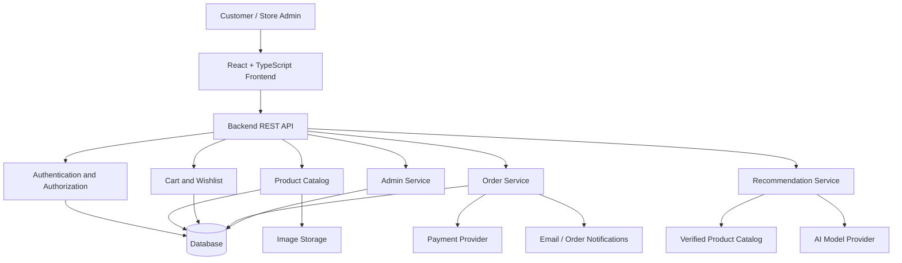

::: {align="center"}
# 🍦 SWEET SCOOP

### Artisanal Ice Cream · Crafted for Every Craving

**Discover your perfect scoop. Customize your cravings. Make every
moment sweeter.**

`<a href="https://sweet-scoop-vava.vercel.app/">`{=html}
``{=html}
`</a>`{=html}

` `{=html}` `{=html}

:::📚 Table of Contents
- Overview
- Product Vision
- Feature Overview
- Customer Experience
- AI Recommendation Platform
- Proposed Full-Stack
  Architecture
- Technology Stack
- Project Structure
- Getting Started
- Environment Configuration
- Proposed API Design
- Proposed Data Model
- Security and Reliability
- Testing Strategy
- Deployment
- Roadmap
- Contributing
- Developer
- License
🍨 Overview
Sweet Scoop is a modern ice cream e-commerce experience designed to
make discovering and ordering desserts enjoyable, visual, and personal.
The platform brings together flavor discovery, product browsing, custom
combo creation, a shopping cart, wishlist functionality, checkout, and
order management in a playful storefront.
The long-term vision is to evolve Sweet Scoop into a full-stack dessert
commerce platform with catalog-backed AI recommendations, personalized
shopping, store administration, inventory management, and sales
insights.
Discover. Customize. Savor.

Live Store: https://sweet-scoop-vava.vercel.app/
Project principles
- Flavor-first discovery: Help customers find products by flavor,
  category, ingredient, and craving.
- Personalization: Make it easy to create combinations that match
  individual preferences.
- Convenient commerce: Keep cart, checkout, and order workflows
  clear.
- Trustworthy recommendations: Base recommendations on verified
  catalog data.
- Responsive design: Deliver a consistent experience across
  desktop, tablet, and mobile.
- Honest product status: Clearly distinguish implemented
  functionality from planned capabilities.
🎯 Product Vision
Sweet Scoop aims to move beyond a basic product catalog and create a
personalized dessert-shopping journey.
Discover
   ↓
Explore flavors
   ↓
Compare products
   ↓
Build a custom combo
   ↓
Get recommendations
   ↓
Save favorites
   ↓
Add to cart
   ↓
Checkout
   ↓
Track the order
   ↓
Enjoy the perfect scoop 🍦
✨ Feature Overview
The source project README describes the following customer and store
capabilities. Actual behavior should be confirmed against the current
implementation before representing each item as production-ready.
🍦 Product Discovery
- Browse ice cream products and flavor categories.
- View product images, descriptions, and pricing.
- Search and filter products.
- Sort products and explore featured selections.
- Discover new arrivals and popular flavors.
- Explore categories such as chocolate, strawberry, vanilla, mango,
  nuts, cookies, coffee, caramel, premium flavors, and combos.
🎁 Custom Combo Builder
The intended combo-building experience lets customers assemble a
personalized dessert selection.
Choose a base
    ↓
Select flavors
    ↓
Choose quantity
    ↓
Add toppings
    ↓
Choose size
    ↓
Review price
    ↓
Add combo to cart
Potential combo options include multiple flavors, topping selection,
size selection, quantity controls, and dynamic pricing. Pricing must be
calculated or validated by a trusted backend before checkout in a
full-stack deployment.
❤️ Wishlist
- Save favorite products.
- Remove saved products.
- Review saved selections.
- Move products to the shopping cart.
- Persist wishlist state where supported.
🛒 Shopping Cart
- Add and remove products.
- Update quantities.
- Review item prices and subtotals.
- Display eligible discounts and delivery charges.
- Calculate an order total.
- Continue to checkout.
The server should recalculate prices, discounts, inventory, and totals
instead of trusting values supplied by the browser.
💳 Checkout
The intended checkout flow is:
1. Review cart items.
2. Enter customer details.
3. Provide a delivery address.
4. Review the order summary.
5. Select an available payment method.
6. Submit the order and view confirmation.
The original project description mentions online payment and Cash on
Delivery. Real payment processing requires a configured provider,
server-side verification, and appropriate testing.
📦 Order Management
Planned order lifecycle:
Order placed
    ↓
Order confirmed
    ↓
Preparing
    ↓
Out for delivery
    ↓
Delivered
Order records can include an order ID, products, quantities, total,
delivery information, payment method, current status, and order date.
👤 Customer Account
The proposed account experience includes profile management, saved
addresses, order history, wishlist, cart, preferences, and account
settings.
📊 Store Management
A future administrative dashboard can support:
- Product and category management.
- Inventory and pricing updates.
- Custom combo management.
- Order processing.
- Customer support workflows.
- Sales analytics and best-selling product reports.
🤖 AI Recommendation Platform
Sweet Scoop's planned AI layer is intended to help customers discover
flavors and combinations based on their preferences.
1. AI Shopping Assistant
Example customer request:
"I want something chocolatey but not too sweet."

A catalog-grounded assistant could retrieve matching products and
explain the differences in flavor profile, ingredients, and customer
ratings when that information is available in verified product records.
2. Personalized Recommendations
Potential recommendation signals include:
- Favorite flavors.
- Product categories.
- Customer-selected preferences.
- Current cart items.
- Previous purchases, with appropriate consent.
- Product popularity and verified ratings.
3. Smart Combo Suggestions
The assistant could propose combinations based on selected flavors,
size, toppings, budget, and catalog rules.
Recommended AI workflow
Customer preferences
        +
Verified product catalog
        +
Available inventory
        ↓
Recommendation service
        ↓
Validate product IDs and availability
        ↓
Return matching products
        ↓
Customer reviews and selects
AI implementation principles
- Keep private AI credentials on the server.
- Ground product suggestions in the actual catalog.
- Validate generated product IDs against the database.
- Do not invent prices, ingredients, stock, or ratings.
- Treat allergy and dietary information carefully and rely on verified
  product labeling.
- Provide ordinary search as a fallback if the AI service is
  unavailable.
- Collect and use customer behavior data only with appropriate
  transparency and consent.
Status: The uploaded README describes AI integration and
capabilities, but this document does not independently verify the
implementation or model provider. Confirm the current code before
claiming production-ready AI functionality.
🏗️ Proposed Full-Stack Architecture
The current live site is hosted on Vercel. The following architecture is
a proposed extension for a complete commerce backend, not a claim that
these services are already deployed.

Architecture principles
- Keep presentation separate from business logic.
- Centralize sensitive operations in backend services.
- Validate user input at the API boundary.
- Enforce customer and administrator permissions on the server.
- Recheck product availability and prices during checkout.
- Make payment and order processing idempotent where appropriate.
- Keep external API keys and database credentials out of client code.
🛠️ Technology Stack
Frontend foundation
  Technology       Purpose
  React            Component-based interface
  TypeScript       Type safety and maintainability
  Vite             Development server and build tooling
  Tailwind CSS     Responsive styling
  HTML5 and CSS3   Web structure and presentation
  Vercel           Frontend deployment
Proposed full-stack extensions
  Technology                             Purpose
  Node.js                                Backend runtime
  Express.js                             REST API and business logic
  PostgreSQL or MongoDB                  Persistent application data
  Prisma, if using PostgreSQL            Database access and migrations
  Secure sessions or JWT                 Authentication
  Gemini API or another model provider   AI shopping assistant
  Cloudinary or equivalent               Product image storage
  Razorpay                               Payment integration
  Resend or equivalent                   Transactional email
  Vitest                                 Unit and component tests
  Playwright                             End-to-end tests
Choose one primary database based on the actual data model. The
technologies in the proposed section are options, not installed
dependencies confirmed by the uploaded README.
📁 Recommended Project Structure
Adapt this structure to the existing repository instead of replacing
working files unnecessarily.
Frontend
sweet-scoop/
├── public/
│   ├── images/
│   ├── icons/
│   └── assets/
├── src/
│   ├── components/
│   │   ├── layout/
│   │   ├── products/
│   │   ├── cart/
│   │   ├── wishlist/
│   │   ├── combo-builder/
│   │   └── ai-chat/
│   ├── pages/
│   ├── services/
│   ├── hooks/
│   ├── context/
│   ├── data/
│   ├── types/
│   ├── utils/
│   ├── styles/
│   ├── App.tsx
│   └── main.tsx
├── tests/
├── .env.example
├── package.json
├── vite.config.ts
└── README.md
Proposed backend
server/
├── src/
│   ├── config/
│   ├── middleware/
│   ├── modules/
│   │   ├── auth/
│   │   ├── products/
│   │   ├── categories/
│   │   ├── cart/
│   │   ├── wishlist/
│   │   ├── combos/
│   │   ├── orders/
│   │   ├── payments/
│   │   ├── recommendations/
│   │   └── analytics/
│   ├── services/
│   ├── validators/
│   ├── utils/
│   ├── app.ts
│   └── server.ts
├── tests/
├── package.json
└── .env.example
⚙️ Getting Started
Prerequisites
- Node.js compatible with the project's Vite version.
- npm.
- Git.
- A code editor such as Visual Studio Code.
1. Clone the repository
git clone <YOUR_GITHUB_REPOSITORY_URL>
cd sweet-scoop
Replace the placeholder with the actual repository URL. The uploaded
README provides the live deployment URL but does not establish the
repository's canonical URL.
2. Install dependencies
npm install
3. Run the development server
npm run dev
Open the local URL printed by Vite, commonly http://localhost:5173.
4. Build for production
npm run build
5. Preview the production build
npm run preview
Confirm the available scripts in package.json before using these
commands.
🔐 Environment Configuration
A frontend-only deployment may not need server-side secrets. For the
proposed backend, create a server-side .env file and use placeholders
in .env.example.
NODE_ENV=development
PORT=5000

DATABASE_URL=your_database_connection_string
SESSION_SECRET=your_long_random_secret

AI_API_KEY=your_server_side_ai_api_key

IMAGE_STORAGE_NAME=your_storage_name
IMAGE_STORAGE_KEY=your_storage_key
IMAGE_STORAGE_SECRET=your_storage_secret

PAYMENT_KEY_ID=your_test_key_id
PAYMENT_KEY_SECRET=your_test_key_secret

CLIENT_URL=http://localhost:5173
These variable names are illustrative. Match them to the services and
configuration implemented in the code.
Security checklist
- Never commit .env files or real secrets.
- Keep private API keys on the backend.
- Do not expose payment secrets in frontend variables.
- Use separate development and production credentials.
- Configure environment variables through the hosting provider.
- Rotate any credential that has been accidentally committed.
🔌 Proposed API Design
The following endpoints are examples for the planned backend.
  Method                  Endpoint                    Purpose
  GET                     /api/products             List products with
                                                      search and filters
  GET                     /api/products/:id         Retrieve product
                                                      details
  GET                     /api/categories           List categories
  GET                     /api/cart                 Retrieve the current
                                                      cart
  POST                    /api/cart/items           Add an item to the cart
  GET                     /api/wishlist             Retrieve saved products
  POST                    /api/combos/quote         Validate a combo and
                                                      calculate its price
  POST                    /api/orders               Create an order
  GET                     /api/orders               Retrieve the current
                                                      customer's orders
  POST                    /api/ai/recommendations   Request
                                                      catalog-grounded
                                                      suggestions
  POST                    /api/payments/verify      Verify payment status
  GET                     /api/admin/analytics      Retrieve authorized
                                                  store analytics
These endpoints should only be documented as available after they are
implemented and tested. Protected endpoints must enforce authorization
on the server.
🗄️ Proposed Data Model
  Entity             Example fields
  Users              id, name, email, role
  Products           id, name, description, category, price, status
  Product Variants   product_id, size, flavor, price
  Ingredients        product_id, ingredient list, allergen declarations
  Inventory          product_id, available quantity, updated_at
  Carts              user_id, items, quantities
  Wishlists          user_id, product_ids
  Combos             name, allowed flavors, sizes, pricing rules
  Orders             user_id, status, total, delivery details
  Order Items        order_id, product_id, quantity, price snapshot
  Payments           order_id, provider reference, status
  Coupons            code, eligibility, discount, expiry
  Reviews            user_id, product_id, rating, comment
Data integrity
- Store prices using a consistent currency representation.
- Recalculate prices and discounts on the server.
- Validate quantities and inventory before order confirmation.
- Preserve the price snapshot for each order item.
- Verify payment events before marking an order as paid.
- Protect customer records and prevent access to another user's
  orders.
🛡️ Security and Reliability
A production-oriented commerce implementation should include:
- Input validation and safe error handling.
- Secure authentication and password hashing.
- Server-side role-based access control.
- Rate limiting on authentication and sensitive endpoints.
- Restricted CORS configuration.
- Server-side inventory and price validation.
- Verified payment webhooks.
- Idempotent order and payment processing.
- Safe image upload validation.
- Appropriate logging without exposing secrets.
- Privacy-conscious handling of customer data.
🧪 Testing Strategy
Recommended quality checks include:
Build
npm run build
Unit tests
npm run test
End-to-end tests
npx playwright test
The test commands require the corresponding dependencies and scripts to
be configured.
Important scenarios
- Product search, filtering, and sorting.
- Combo configuration and price calculation.
- Cart quantity updates and totals.
- Coupon eligibility and expiration.
- Inventory changes during checkout.
- Payment success, failure, and duplicate events.
- Order authorization and status transitions.
- AI recommendations referencing real products.
- Mobile responsiveness and accessibility.
🚀 Deployment
Frontend on Vercel
1. Push the project to GitHub.
2. Import the repository into Vercel.
3. Configure the project root directory.
4. Set the build command to npm run build.
5. Set the output directory to dist for a standard Vite build.
6. Configure any required public environment variables.
7. Deploy and test the production site.
Live Store: https://sweet-scoop-vava.vercel.app/
Backend on Render or an equivalent host
When the backend is implemented:
1. Create a backend service.
2. Configure build and start commands.
3. Add server-side environment variables.
4. Configure database connectivity.
5. Restrict CORS to trusted origins.
6. Test authentication, orders, and payment verification.
7. Configure monitoring, backups, and error reporting.
🗺️ Development Roadmap
Phase 1: Storefront
- [x] Live storefront deployment.
- [x] Product discovery foundation.
- [x] Responsive design direction.
- [ ] Verify cart and wishlist persistence.
- [ ] Complete product detail and filtering workflows.
The checked items reflect the source README's description and deployment
claim, not an independent code audit.
Phase 2: Commerce Backend
- [ ] REST API and database.
- [ ] Customer authentication.
- [ ] Persistent cart and wishlist.
- [ ] Server-validated combo pricing.
- [ ] Inventory management.
- [ ] Order creation and status management.
Phase 3: Payments and Operations
- [ ] Payment provider integration.
- [ ] Verified payment webhooks.
- [ ] Order notifications.
- [ ] Admin product and order management.
- [ ] Revenue and product analytics.
Phase 4: AI and Personalization
- [ ] Catalog-grounded AI shopping assistant.
- [ ] Preference-based recommendations.
- [ ] Smart combo suggestions.
- [ ] Personalized product collections.
- [ ] Recommendation quality evaluation.
Phase 5: Production Readiness
- [ ] Automated tests.
- [ ] Security review.
- [ ] Accessibility audit.
- [ ] Performance optimization.
- [ ] Monitoring and recovery procedures.
Only mark features complete once their implementation and behavior have
been verified.
📈 Business Value
If implemented and measured using real store data, Sweet Scoop could
help a business understand:
- Most popular flavors.
- Best-selling products and combos.
- Average order value.
- Repeat purchase patterns.
- Inventory movement.
- Customer engagement.
- Coupon performance.
- Product demand trends.
Do not present sample analytics or illustrative figures as actual
business results.
🤝 Contributing
Contributions, bug reports, and feature suggestions are welcome.
1. Fork the repository.
2. Create a feature branch:
   git checkout -b feature/your-feature
3. Implement and test your changes.
4. Commit your work:
   git commit -m "feat: describe your change"
5. Push the branch:
   git push origin feature/your-feature
6. Open a pull request describing your changes.
👨‍💻 Developer
Mugunthan DK
Full Stack Developer | AI/ML Enthusiast
B.Tech Information Technology, VSB Engineering College
- Live Project: https://sweet-scoop-vava.vercel.app/
- GitHub: https://github.com/Mugunthandk
- LinkedIn: https://www.linkedin.com/in/mugunthandk/
- Portfolio: https://mugunthandk-portfolio-vvuy.vercel.app/
Interested in building modern web applications, AI-powered products, and
practical software solutions.
📄 License
The source README does not identify a specific license. Add a LICENSE
file with the intended terms before describing the project as open
source.
::: {align="center"}
# 🍦 SWEET SCOOP

### Discover · Customize · Savor

**Every craving deserves a perfect scoop. 🍨**

[Visit the Live Store](https://sweet-scoop-vava.vercel.app/)

Built with ❤️ by **Mugunthan DK**
:::
