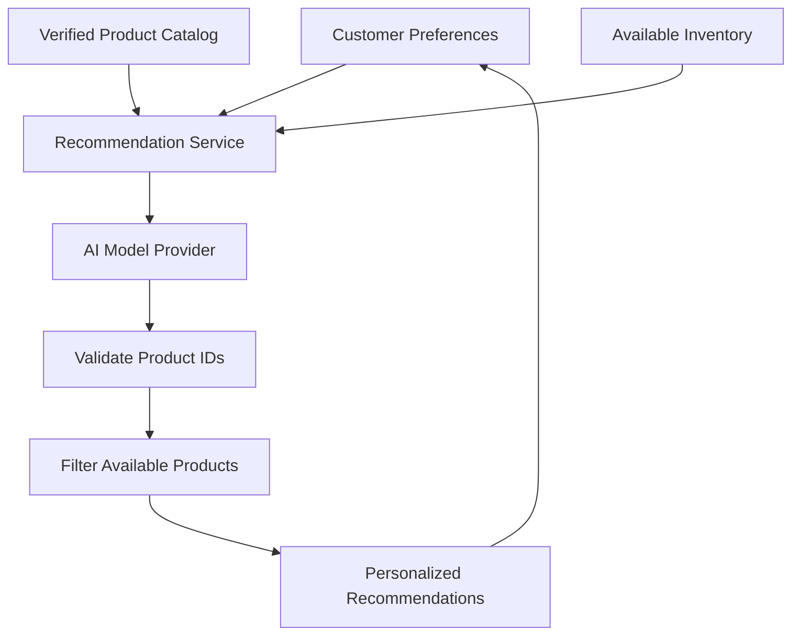

# 🍦 SWEET SCOOP

### AI-Powered Dessert Discovery & E-Commerce Platform

> **Discover Your Perfect Scoop. Customize Your Cravings. Make Every Moment Sweeter.**

<div align="center">

[](https://sweet-scoop-vava.vercel.app/)


**A modern dessert-shopping experience combining personalized discovery, customizable ice cream combos, and intelligent product recommendations.**

[Live Demo](https://sweet-scoop-vava.vercel.app/) · [GitHub](https://github.com/Mugunthandk) · [LinkedIn](https://www.linkedin.com/in/mugunthandk/)

⭐ If you enjoy this project, consider starring the repository!

</div>

---

## 📖 1. Project Overview

**Sweet Scoop** is a modern ice cream e-commerce platform concept designed to make discovering, customizing, and ordering desserts enjoyable and convenient.

The platform brings together flavor discovery, product browsing, personalized combinations, shopping cart management, wishlist functionality, and checkout in a playful, visually engaging storefront.

Its long-term vision is to evolve into a full-stack dessert commerce platform with AI-powered recommendations, customer accounts, inventory management, order tracking, and business analytics.

### 🎯 Project Objectives

- Deliver a premium, responsive dessert-shopping experience.
- Simplify flavor discovery through search and categorization.
- Enable personalized ice cream combinations.
- Make shopping cart and checkout workflows intuitive.
- Introduce AI-assisted flavor and combo recommendations.
- Build a scalable foundation for orders, inventory, and payments.
- Provide a consistent experience across desktop, tablet, and mobile.

---

## ✨ 2. Core Features

### 🍨 Smart Product Discovery

- Browse ice cream products and flavor categories.
- Explore product images, descriptions, and prices.
- Search, filter, and sort products.
- Discover popular flavors and featured collections.
- Explore chocolate, strawberry, vanilla, mango, nuts, cookies, coffee, and caramel varieties.
- Discover premium flavors and curated combos.

### 🎨 Custom Ice Cream Combo Builder

Create personalized dessert combinations using configurable selections.

**Proposed workflow**

```text
          Choose a Base
               |
               v
          Select Flavors
               |
               v
          Add Toppings
               |
               v
          Select Size
               |
               v
        Choose Quantity
               |
               v
        Calculate Price
               |
               v
          Review Combo
               |
               v
          Add to Cart
```

Potential capabilities:

- Multiple flavor selection.
- Custom toppings.
- Size and quantity controls.
- Dynamic price estimates.
- Combo previews.
- Cart integration.
- Validation of available options.

Final pricing and availability should be validated by the backend when full-stack commerce is implemented.

### ❤️ Wishlist

- Save favorite products.
- Remove saved items.
- Review favorite flavors.
- Move products to the cart.
- Persist selections when supported.

### 🛒 Shopping Cart

- Add and remove products.
- Update item quantities.
- Display product prices and subtotals.
- Calculate order totals.
- Apply eligible discounts.
- Show delivery charges where applicable.
- Continue to checkout.

### 💳 Checkout & Payments

**Planned full-stack capabilities**

- Customer information and delivery addresses.
- Order summary.
- Payment method selection.
- Online payment integration.
- Cash on Delivery where supported.
- Order confirmation.
- Payment status verification.

Real payment processing requires a configured provider and secure server-side verification.

### 📦 Order Management

The proposed order lifecycle is:

`Order Placed → Confirmed → Preparing → Out for Delivery → Delivered`

Additional capabilities may include order history, delivery instructions, order notifications, and cancellation according to business rules.

---

## 🤖 3. AI Recommendation Platform

The planned AI recommendation system aims to help customers discover flavors and combinations based on their cravings, preferences, and budget.

### AI Shopping Assistant

Example customer request:

> "I want something chocolatey but not too sweet. Suggest a combo under ₹300."

The assistant could recommend matching products from the verified catalog, explain their flavor profiles, and offer suitable combinations within the requested budget.

### Personalized Recommendations

Potential recommendation signals:

- Preferred flavors.
- Selected product categories.
- Customer-defined preferences.
- Current cart contents.
- Previous purchases, where appropriate consent is obtained.
- Verified product ratings and popularity.

### AI Recommendation Architecture



### AI reliability principles

- Keep private AI credentials on the backend.
- Ground recommendations in actual catalog data.
- Validate every recommended product ID.
- Never invent prices, ingredients, ratings, or stock.
- Use verified ingredient and allergen information.
- Provide ordinary product search as a fallback.
- Respect customer privacy and consent.

**Implementation status:** AI recommendations are a planned capability unless the current code already contains a working, tested integration.

---

## 🏗️ 4. System Architecture

The following architecture describes a proposed full-stack version of Sweet Scoop.

```mermaid
flowchart TD
    U[Customer / Store Admin] --> FE[React + TypeScript Frontend]
    FE --> API[Backend REST API]

    API --> AUTH[Authentication]
    API --> CAT[Product Catalog]
    API --> CART[Cart and Wishlist]
    API --> COMBO[Combo Builder]
    API --> ORD[Order Management]
    API --> AI[AI Recommendations]

    AUTH --> DB[(Database)]
    CAT --> DB
    CART
