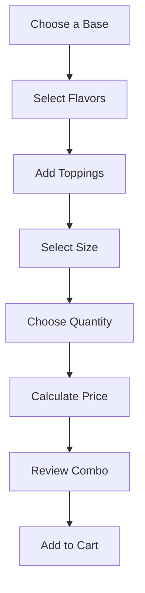
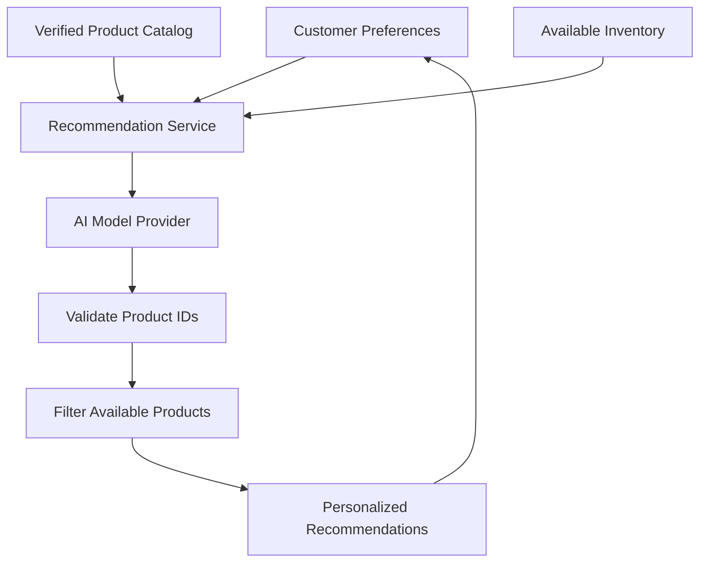
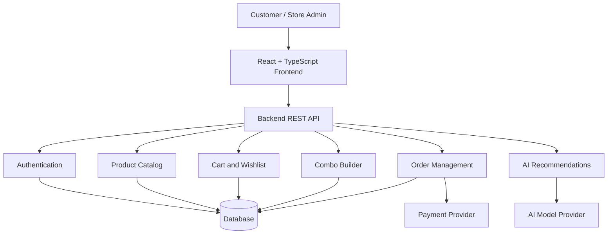

# 🍦 SWEET SCOOP

### AI-Powered Dessert Discovery & E-Commerce Platform

> **Discover Your Perfect Scoop. Customize Your Cravings. Make Every Moment Sweeter.**

<div align="center">

[](https://sweet-scoop-vava.vercel.app/)


**A modern dessert-shopping experience combining personalized discovery, customizable ice cream combos, and intelligent product recommendations.**

[Live Demo](https://sweet-scoop-vava.vercel.app/) · [GitHub](https://github.com/Mugunthandk) · [LinkedIn](https://www.linkedin.com/in/mugunthandk/)

⭐ If you enjoy this project, consider starring the repository!

</div>

---

## 📖 1. Project Overview

**Sweet Scoop** is a modern ice cream e-commerce platform concept designed to make discovering, customizing, and ordering desserts enjoyable and convenient.

The platform brings together flavor discovery, product browsing, personalized combinations, shopping cart management, wishlist functionality, and checkout in a playful, visually engaging storefront.

Its long-term vision is to evolve into a full-stack dessert commerce platform with AI-powered recommendations, customer accounts, inventory management, order tracking, and business analytics.

### 🎯 Project Objectives

- Deliver a premium, responsive dessert-shopping experience.
- Simplify flavor discovery through search and categorization.
- Enable personalized ice cream combinations.
- Make shopping cart and checkout workflows intuitive.
- Introduce AI-assisted flavor and combo recommendations.
- Build a scalable foundation for orders, inventory, and payments.
- Provide a consistent experience across desktop, tablet, and mobile.

---

## ✨ 2. Core Features

### 🍨 Smart Product Discovery

- Browse ice cream products and flavor categories.
- Explore product images, descriptions, and prices.
- Search, filter, and sort products where implemented.
- Discover popular flavors and featured collections.
- Explore chocolate, strawberry, vanilla, mango, nuts, cookies, coffee, and caramel varieties.
- Discover premium flavors and curated combos.

### 🎨 Custom Ice Cream Combo Builder

Create personalized dessert combinations using configurable selections.

**Proposed workflow**



Potential capabilities:

- Multiple flavor selection.
- Custom toppings.
- Size and quantity controls.
- Dynamic price estimates.
- Combo previews.
- Cart integration.
- Validation of available options.

Final pricing and availability should be validated by the backend when full-stack commerce is implemented.

### ❤️ Wishlist

- Save favorite products.
- Remove saved items.
- Review favorite flavors.
- Move products to the cart.
- Persist selections when supported.

### 🛒 Shopping Cart

- Add and remove products.
- Update item quantities.
- Display product prices and subtotals.
- Calculate order totals.
- Apply eligible discounts.
- Show delivery charges where applicable.
- Continue to checkout.

### 💳 Checkout & Payments

**Planned full-stack capabilities**

- Customer information and delivery addresses.
- Order summary.
- Payment method selection.
- Online payment integration.
- Cash on Delivery where supported.
- Order confirmation.
- Payment status verification.

Real payment processing requires a configured provider and secure server-side verification.

### 📦 Order Management

The proposed order lifecycle is:

`Order Placed → Confirmed → Preparing → Out for Delivery → Delivered`

Additional capabilities may include order history, delivery instructions, order notifications, and cancellation according to business rules.

---

## 🤖 3. AI Recommendation Platform

The planned AI recommendation system aims to help customers discover flavors and combinations based on their cravings, preferences, and budget.

### AI Shopping Assistant

Example customer request:

> "I want something chocolatey but not too sweet. Suggest a combo under ₹300."

The assistant could recommend matching products from the verified catalog, explain their flavor profiles, and offer suitable combinations within the requested budget.

### Personalized Recommendations

Potential recommendation signals:

- Preferred flavors.
- Selected product categories.
- Customer-defined preferences.
- Current cart contents.
- Previous purchases, where appropriate consent is obtained.
- Verified product ratings and popularity.

### AI Recommendation Architecture



### AI Reliability Principles

- Keep private AI credentials on the backend.
- Ground recommendations in actual catalog data.
- Validate every recommended product ID.
- Never invent prices, ingredients, ratings, or stock.
- Use verified ingredient and allergen information.
- Provide ordinary product search as a fallback.
- Respect customer privacy and consent.

**Implementation status:** AI recommendations are a planned capability unless the current code already contains a working, tested integration.

---

## 🏗️ 4. System Architecture

The following architecture describes a proposed full-stack version of Sweet Scoop.



### Architecture Principles

- **Separation of concerns:** Keep frontend, business logic, and data access organized.
- **Security:** Protect user information and private credentials.
- **Data integrity:** Validate product availability and order totals on the server.
- **Scalability:** Introduce backend services as requirements grow.
- **Reliability:** Handle errors and payment failures safely.

This diagram represents a proposed architecture, not a claim that every service is currently deployed.

---

## 🛠️ 5. Technology Stack

| Layer | Technology |
|---|---|
| Frontend | React |
| Language | TypeScript |
| Build Tool | Vite |
| Styling | Tailwind CSS |
| Hosting | Vercel |
| Backend | Planned: Node.js and Express |
| Database | Planned: PostgreSQL, MongoDB, or Firebase |
| Authentication | Planned: suitable authentication provider |
| AI | Planned: server-side AI integration |
| Payments | Planned: supported payment gateway |
| Version Control | Git and GitHub |

The deployed frontend uses the technologies listed in the project badges. Confirm the repository configuration before treating every proposed backend technology as implemented.

---

## 📂 6. Project Structure

Example structure for a React and TypeScript application:

```text
sweet-scoop/
├── public/
│   ├── images/
│   └── assets/
├── src/
│   ├── assets/
│   ├── components/
│   ├── pages/
│   ├── layouts/
│   ├── hooks/
│   ├── services/
│   ├── types/
│   ├── utils/
│   ├── App.tsx
│   └── main.tsx
├── .env.example
├── .gitignore
├── package.json
├── tsconfig.json
├── vite.config.ts
└── README.md
```

*This is an illustrative structure. Adapt it to match the actual repository.*

---

## ⚙️ 7. Installation & Setup

### Prerequisites

- Node.js and npm.
- Git.
- Visual Studio Code or another code editor.

### Step 1: Clone the Repository

```bash
git clone YOUR_GITHUB_REPOSITORY_URL
```

### Step 2: Navigate to the Project

```bash
cd sweet-scoop
```

### Step 3: Install Dependencies

```bash
npm install
```

### Step 4: Configure Environment Variables

Create a `.env` file only if your project requires environment variables.

Example:

```env
VITE_APP_NAME=Sweet Scoop
```

Never expose private API keys, payment secrets, or database credentials through frontend environment variables.

### Step 5: Start the Development Server

```bash
npm run dev
```

Open the local URL shown in your terminal.

### Step 6: Build for Production

```bash
npm run build
```

Preview the production build:

```bash
npm run preview
```

---

## 🔐 8. Security & Payment Safety

A production-ready commerce platform should implement:

- Server-side price and inventory validation.
- Secure authentication and authorization.
- Server-side payment verification.
- Verified payment webhooks.
- Input validation and sanitization.
- Rate limiting for sensitive endpoints.
- Secure handling of customer data.
- HTTPS in production.
- Environment-based secret management.
- Appropriate logging and error handling.

The frontend must never be trusted as the sole source of truth for order totals, stock availability, or payment status.

---

## 🧪 9. Testing Strategy

| Test Type | Purpose |
|---|---|
| Unit Testing | Validate individual components and functions |
| Integration Testing | Check interactions between modules |
| UI Testing | Verify shopping workflows |
| API Testing | Validate backend endpoints |
| Payment Testing | Test provider sandbox workflows |
| Accessibility Testing | Improve usability for all users |
| Performance Testing | Measure loading speed and responsiveness |
| Security Testing | Identify common vulnerabilities |

Potential tools include Vitest, React Testing Library, Playwright, and suitable API testing tools.

---

## 🚀 10. Deployment

Sweet Scoop's live storefront:

**[Visit Sweet Scoop](https://sweet-scoop-vava.vercel.app/)**

For frontend deployment using Vercel:

1. Push the project to GitHub.
2. Import the repository into Vercel.
3. Configure the build command as `npm run build`.
4. Set the output directory to `dist`.
5. Configure required environment variables.
6. Deploy the application.
7. Test navigation, responsive layouts, and critical workflows.

If a backend or database is introduced, deploy and configure those services separately.

---

## 🗺️ 11. Future Roadmap

These are proposed enhancements, not confirmed existing features.

- [ ] Complete the product discovery experience.
- [ ] Enhance custom combo configuration.
- [ ] Implement persistent cart and wishlist storage.
- [ ] Add customer authentication.
- [ ] Integrate a production-ready backend.
- [ ] Implement inventory and order management.
- [ ] Integrate secure online payments.
- [ ] Build an AI-powered flavor recommendation assistant.
- [ ] Add customer reviews and verified ratings.
- [ ] Introduce an admin dashboard and sales analytics.
- [ ] Add automated tests and production monitoring.
- [ ] Optimize accessibility and performance.

---

## 🤝 12. Contributing

Contributions, suggestions, and bug reports are welcome.

1. Fork the repository.
2. Create a feature branch.
3. Implement your changes.
4. Test the changes locally.
5. Submit a pull request with a clear description.

## 📄 13. License

Choose an appropriate open-source license before distributing the project. If you choose MIT, add a `LICENSE` file containing the complete license terms.

## 👨‍💻 14. Author

**Mugunthan DK**

- GitHub: [@Mugunthandk](https://github.com/Mugunthandk)
- LinkedIn: [Mugunthan DK](https://www.linkedin.com/in/mugunthandk/)

---

<div align="center">

### 🍦 Sweet Scoop

**Discover Your Perfect Scoop. Customize Your Cravings. Make Every Moment Sweeter.**

Built with ❤️ by Mugunthan DK

[Explore the Live Store](https://sweet-scoop-vava.vercel.app/)

</div>
